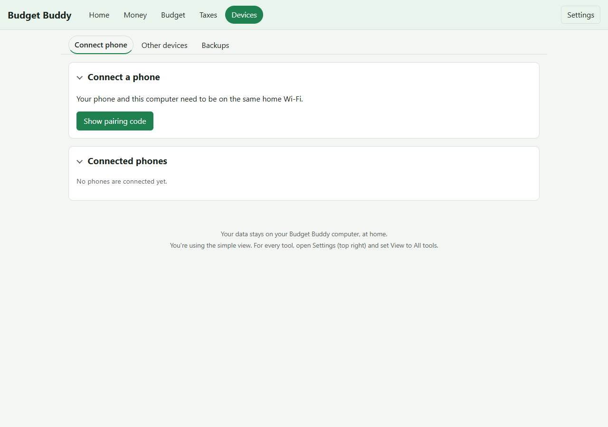

# Connect your phone

Pairing connects your phone to Budget Buddy on this computer. You do it once per phone. Your computer and phone need to be on the same home Wi-Fi.

## Pair your phone

1. Make sure both your phone and computer are on the same home Wi-Fi (not a guest network)
2. Open Budget Buddy on your computer (go to http://127.0.0.1:8765/)
3. Click **Devices** at the top (the **Connect phone** tab opens first)
4. Click **Show pairing code**
5. Budget Buddy shows a one-time QR code that works for 10 minutes
6. On your phone:
   - Open Budget Buddy in Expo Go
   - Go to **Settings**
   - Choose **Connect**
   - Scan the QR code with your phone's camera
7. If the camera can't scan, click **Show code as text** on your computer and paste the text into your phone instead
8. When the phone pairs, you'll see "New phone paired" on your computer

**Important:** the QR code is a one-time key. Don't leave it on screen or share a photo of it. Once your phone is paired, the code is used up.

## Try scanning again

If the first scan doesn't work:
- Check that both are on the same home Wi-Fi (not a guest network)
- Make sure the Wi-Fi is set to **Private** (not Public)
- Move closer to your Wi-Fi router if the signal is weak
- Check that Budget Buddy is running on your computer
- Make the browser window bigger so the QR code is larger, or use **Show code as text**

## Get a new code if it expires

The code only works for 10 minutes. If it runs out, or you want to try again:
- Click **Show pairing code** to get a new one
- The old code stops working right away

## Something went wrong?

**"Budget Buddy can't find your home network"**

This computer isn't on a home network. Connect it to your home Wi-Fi and try again. If it is connected but still can't find it, your computer may have more than one network connection. Ask whoever set up Budget Buddy to set this computer's home-network address in the settings.

**"Budget Buddy couldn't open its home-network connection"**

Check you're on home Wi-Fi and that no other program is using port 8765, then try again.

**"Budget Buddy was set to answer only on this computer"**

Someone set the settings to prevent phone connections. Remove that setting and restart Budget Buddy.

**The phone says the code has expired**

Ask for a new code on your computer and scan again.

**The phone says "Too many tries"**

Wait a minute and scan again.

**The phone says the clock is wrong**

Turn on automatic date and time on both your phone and your computer.

**The phone can't reach your computer**

- Make sure both are on the same home Wi-Fi (not a guest network)
- Make sure Budget Buddy is running on your computer
- Check that your Wi-Fi is set to **Private**
- If Windows asked whether Budget Buddy may use networks, it needs **Private networks** allowed (never Public)

Next: [sync your phone](sync-your-phone.md) to see your real budget on it.
