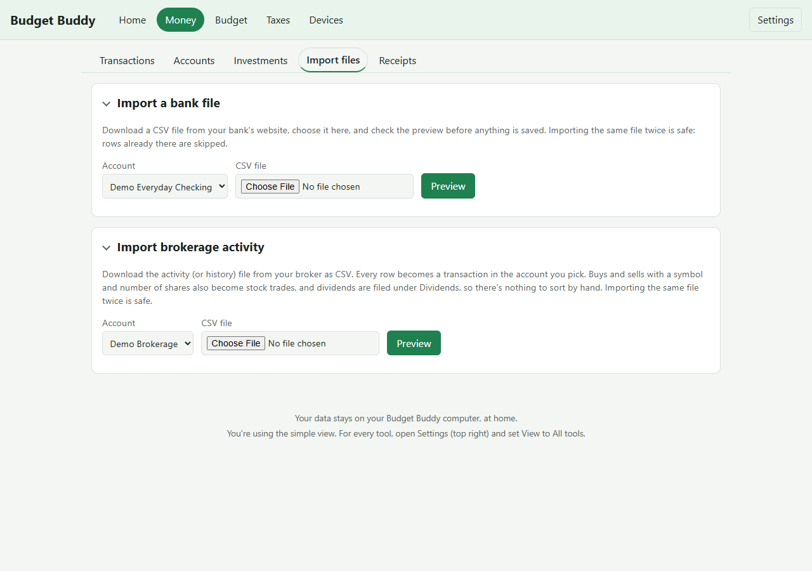

# Import a bank file

Most banks let you download your transactions as a CSV file. Budget Buddy can read that file straight into one of your accounts.

## Before you start

- You need at least one account set up (go to **Accounts** first)
- Download a CSV file from your bank's website (look for "Download", "Export", or "Statements" — pick CSV format)

## Import the file

1. On the Budget Buddy dashboard, click **Money** at the top, then the **Import files** tab
2. Pick the account to import into
3. Click "Choose file" and select the CSV you downloaded
4. Click **Preview**
5. Budget Buddy shows the rows it found. Check that dates and amounts look right
6. If something's wrong (wrong columns, backwards signs), adjust the settings and click **Update preview**
7. Click **Import [number] new row(s)**

## Tips

**Importing the same file twice is safe.** Rows already there are skipped automatically.

**Credit card statements** often show charges as positive numbers. For a credit card account Budget Buddy notices
this and flips them for you (the preview says so), so charges are money out, payments money in, the card shows what
you owe, and your card payment links up with the payment from checking. If it guessed wrong, set "Charges show as
positive numbers?" in the column choices.

Imported a card file before this, and the card shows money you have instead of what you owe? Open **Import
history**, undo that file, and import it again.

**Date formats.** Your bank writes dates in different ways. Budget Buddy usually figures it out, but if it gets it wrong:
- US-style month/day is tried first
- If your bank writes day/month and every day in the file is 12 or less, choose `DD/MM/YYYY` yourself
- Formats understood: `YYYY-MM-DD`, `MM/DD/YYYY`, `MM/DD/YY`, `DD/MM/YYYY`, `DD/MM/YY`, `YYYY/MM/DD`, `MM-DD-YYYY`, `DD.MM.YYYY`, `YYYYMMDD`, `Mon D, YYYY`, `D Mon YYYY` (times after the date are ignored)

**Amounts.** May have `$` signs, thousands commas, `(12.34)` or `12.34-` for negatives. An amount that can't be read exactly is flagged as a problem.

**The first time you import from a bank account.** Budget Buddy asks which column is which. Next time it remembers your choice. You can change your mind and import again with new choices.

**Transfers between your accounts.** Clear ones are linked for you ([Transfers](transfers.md)); link the rest yourself on the Transactions page.

**Dividends.** Are put in the Dividends category, with the deposit sweep that moved the cash on ([Dividends](dividends.md)).

**Rows with problems.** Stop the import and are listed by row number, so nothing half-imports. Fix your choices, or add `skip_invalid_rows=true` to import the rest. Blank lines are ignored.

**File size.** Up to 5 MB and 10,000 rows per file. Text files saved as UTF-8, UTF-16 or Windows-1252 are all fine.

## Something went wrong?

**"There is already a transaction with this date, amount, and description"**

That row is already imported. The import skipped it.

**Transactions were imported but don't show amounts or are in the wrong account**

Check your choices in the import settings. Import the file again with the right settings.

**The file won't upload**

- Check the file size (up to 5 MB, up to 10,000 rows)
- Check that it's a CSV file, not Excel or another format
- Try a different browser
