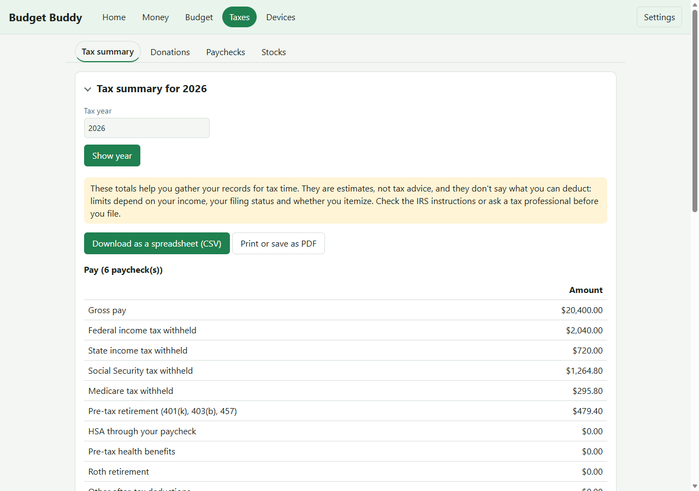

# Tax summary and other deductions

At tax time, Budget Buddy puts the year's numbers on one page: your pay, donations, stock sales and other
deductions. You can download it as a spreadsheet for a tax preparer, or print it.

**These are estimates to help you gather your records, not tax advice.** They don't say how much you can
deduct; that depends on your income, your filing status and whether you itemize.

## Open it

1. Open the dashboard and click **Taxes** at the top. The **Tax summary** tab opens first.
2. Type the tax year at the top and click **Show year**.

## Add other deductions

Paychecks, donations and stocks have their own pages. Everything else goes here, under **Other deductions
this year**:

1. Pick the kind, for example **Medical**, **Mortgage interest** or **IRA contributions**.
2. Type the amount. The date and a short description (like "Dentist") are optional; the date has to be in the
   tax year you're looking at.
3. Click **Add deduction**. To take one out, click **Remove** next to it.

Each kind shows where it usually goes on a federal return:

- **Counts only if you itemize** (medical, mortgage interest, property tax, state and local taxes). Limits
  apply, for example only medical costs above a share of your income count.
- **Can lower your income even if you don't itemize** (student loan interest, HSA, IRA), within limits.
  For HSA, enter only money you put in yourself: HSA money taken from your paycheck is already left out of
  your taxable pay, and the Pay section shows it. For IRA, only a traditional IRA counts, not a Roth, and it
  may be limited if you have a retirement plan at work.
- **May be a tax credit** (education, childcare).
- **Depends on your situation** (home office, other).

Because the kinds follow different rules, Budget Buddy doesn't add them into one total. It shows the year's
**standard deduction** next to them for comparison: if your itemized deductions add up to less, you'd usually
take the standard deduction.

## Download or print

- **Download as a spreadsheet (CSV):** opens in Excel, Google Sheets or Numbers, with one row per item. Keep
  the file somewhere safe: it has your financial details.
- **Print or save as PDF:** opens your browser's print window. To get a PDF, choose "Save as PDF" or
  "Microsoft Print to PDF" as the printer.

## Something went wrong?

- **"The date has to be in the tax year you picked."** Change the date, or pick the right tax year.
- **"A deduction amount can't be negative."** Enter zero or more.
- **"Budget Buddy doesn't have this year's standard deduction yet."** The other totals still work; only the
  comparison is missing for that year.
