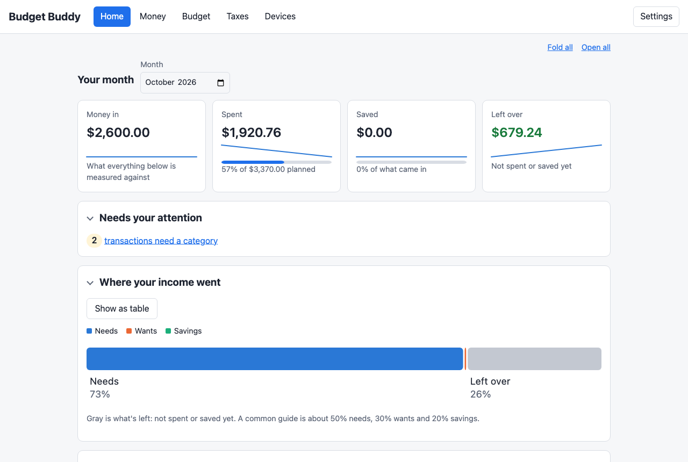
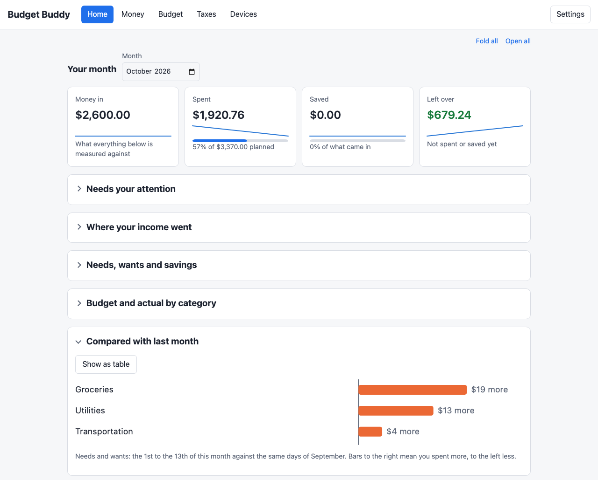
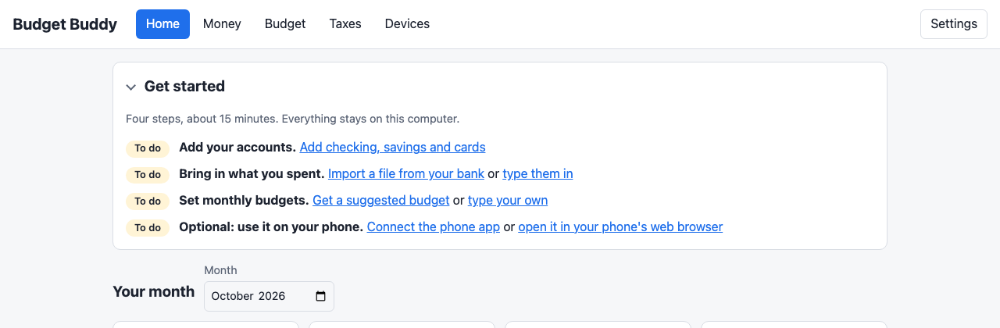
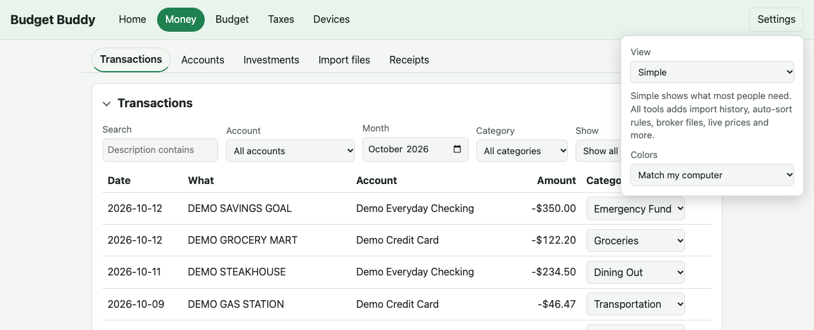
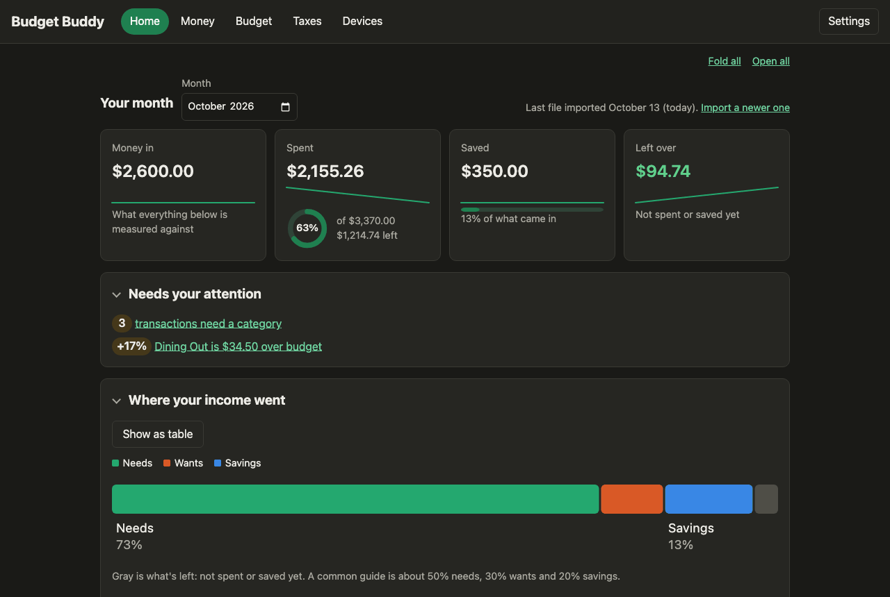
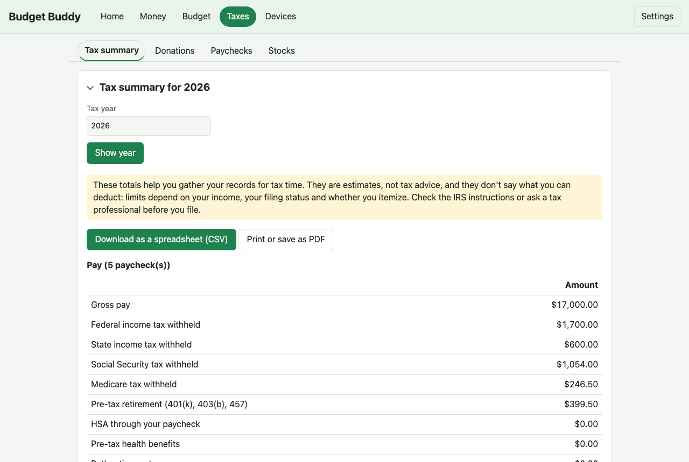
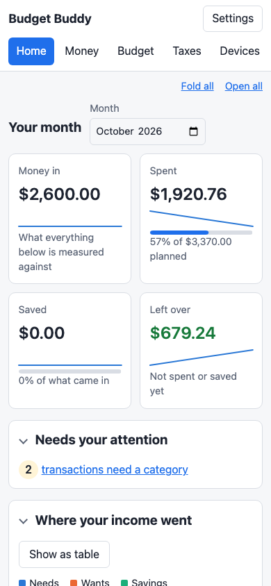
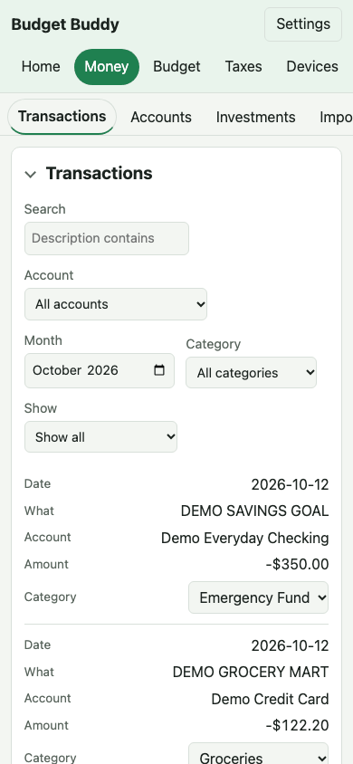

# Budget Buddy: a private money helper that lives at home

*A plain-English tour for anyone, no technical background needed. Every screenshot uses made-up demo data
(screenshots taken 2026-10-13).*

## The idea in one sentence

Budget Buddy keeps your budget, your spending and your tax records **on your own computer**, not in someone
else's cloud, and makes them easy to understand.

Most budgeting apps ask for your bank password and store your money history on their servers. Budget Buddy never
does either. Your records sit on your computer, encrypted, and your phone joins in over your home Wi-Fi.

> Budget Buddy organizes your records and estimates numbers to help you prepare. It isn't tax advice.

## What it does for you

| You want to... | Budget Buddy... |
| --- | --- |
| Know where your money went | Sorts every payment into categories like Groceries or Rent, and shows needs, wants and savings at a glance |
| Stick to a budget | Shows what you've spent against each monthly budget, and can suggest a budget from your last three months |
| Avoid typing everything | Reads the files your bank and broker let you download, remembers how you sort things, and links transfers between your accounts |
| Get ready for tax time | Gathers paychecks, donations, stock sales, dividends and deductions into one yearly summary you can print or download |
| Watch your savings | Shows your investments, and how much room is left this year in your 401(k), IRA and HSA |

## A quick tour

### Home: your month at a glance

Four numbers answer the questions people actually ask: *How much came in? How much did I spend? How much did I
save? What's left?* A ring shows how much of your spending budget is used, and a small line under each number
shows how it went over the past months. Below them, **Needs your
attention** lists anything waiting for you (like a payment with no category); one click takes you there.

### Every budget at a glance, and how this month compares

**Budget and actual by category** shows each category with a thin bar filling up as you spend and what's left
(red when it's over; savings read as goals, like "$200.00 to go"). **Compared with last month** shows, for each kind of spending, whether you spent more or less than last month,
counting the same days so a half-finished month isn't compared with a whole one. **Month by month** shows money in,
spending and saving over time. Every box folds up to its title with one click (or **Fold all**), and Budget Buddy
remembers what you folded, so the page shows what you care about.

### Getting started is a checklist

The first time, Home shows four steps: add your accounts, bring in what you spent, set budgets and, if you like,
connect your phone. Each step links straight to the right page and ticks itself off when it's done.

### Simple by default, powerful when you want it

Budget Buddy starts in a **simple view** with only the everyday pages and buttons. People who want more control
open **Settings** and switch **View** to **All tools**. That adds import history, automatic sorting rules,
broker files, live stock prices, transfer matching and more. Nothing is lost either way; it's just tidied away.

### Light or dark

Budget Buddy is green, and follows your computer's light or dark setting (or pick one in **Settings**): a faintly
green page in light, warm charcoal in dark. Both use the same colors, tuned for their background, so nothing changes
meaning when you switch, and the chart colors are checked for color blindness.

### Tax time without the shoebox

One page per tax year collects pay and taxes withheld, donations, stock gains and losses, and other deductions,
with a button to download it as a spreadsheet or print it for your tax preparer.

### On your phone

  
  

At home, open Budget Buddy in your phone's web browser: no app store and nothing to install. The pages rearrange
to fit a small screen. (A phone app that takes receipt photos and shows your budget offline is in testing.)

## Getting it

1. Download the Windows zip from the project's Releases page.
2. Unzip it and double-click **Install Budget Buddy**.
3. Open it from the Start menu and follow the **Get started** list.

Step-by-step help: [Download and install Budget Buddy](../guide/install.md) and [the user guide](../guide/README.md).

## Is my information safe?

- **It stays home.** No account to create, no bank passwords, no cloud. The only optional outside connection is
  live stock prices, and that sends only symbols like "VTI", never amounts.
- **It's encrypted.** The private key is held by Windows' own password vault, and receipt photos are encrypted
  before they're saved.
- **You decide who joins.** A phone or another computer can only connect with a one-time code shown on your
  computer, and you can remove it any time.

More: [Keep your data safe](../guide/keep-your-data-safe.md).

## Who's behind it

Budget Buddy is open source (MIT license). The code is built by Claude Code, Anthropic's AI coding assistant; the
design and every review are done by the project's owner, who decides what gets built and approves each change.
For how it works under the hood, see the [technical overview](technical.md).
